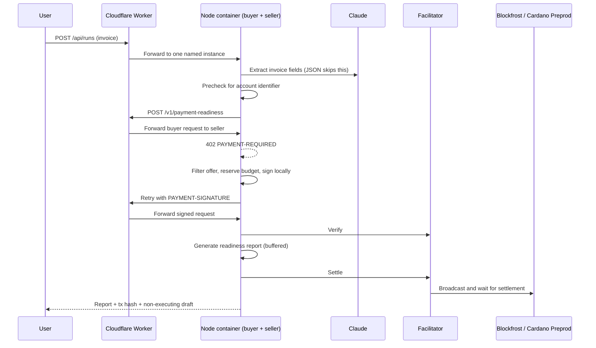

# PayFlow AI

**Pay-per-call payment readiness for autonomous agents.**

An agent sends a supplier invoice to the PayFlow Readiness API and pays for a report with
x402, using **tADA on Cardano Preprod (testnet)**. The report checks account details, required
fields and duplicates, and shows **Simulated route/fees**. Our Claude-powered demo customer
ends with a draft awaiting human approval; no supplier payout is executed.

**PayFlow AI** — the AI CFO that checks before it pays. Claude reads. Code decides. You approve. Fiat payouts run on [CashXChain](https://cashxchain.com) rails (sandbox).

**AI CFO product:** the same app now also serves a marketing site at `/`, accounts at `/signup`, and a
dashboard at `/app`. In the dashboard, users connect wallets and accounts with read or read & write
access, upload any financial document, chat with the AI CFO, plan budgets and cash, and approve
payments, all under a deterministic agent permission policy. The hackathon demo moved to `/demo`.
See [docs/AI-CFO.md](docs/AI-CFO.md).

## Demo and proof

| Resource | Status |
| --- | --- |
| [Source repository](https://github.com/CashXChain-Research/cxc-agentpay) | Public visibility still needs an unauthenticated check |
| Live demo | `<LIVE_URL>` — pending workstream C |
| Demo video | `<VIDEO_URL>` — pending recording on the live deployment |
| Payment proof | `<TX_LINK>` — pending workstream A's `evidence/milestone1-*.json` and explorer verification |

These are release placeholders, not evidence of a deployed app or successful settlement.
The checked-in implementation includes the x402 flow; a live payment has not yet been
established by evidence in this checkout. See the [submission handoff](docs/SUBMISSION.md).

## How it works in 60 seconds



This is the intended deployment flow; Cloudflare deployment is still pending verification.
The buyer signs locally and does not broadcast. The facilitator holds no funds and broadcasts
the signed transaction. The seller returns the paid report only after successful settlement.
See [architecture and open verification items](docs/ARCHITECTURE.md).

## Trust boundary

Claude extracts invoice fields; it receives no authority to choose a wallet, endpoint, price
or spending limit. Deterministic code checks `exact`, `cardano:preprod`, `lovelace`, the seller
allowlist, the price cap, available session budget and invoice payment locks before signing.
Defaults are 2 tADA per report, a 3 tADA price cap and a 20 tADA session budget; network fees
are additional and are not included in that report-price ledger.

The buyer serializes report purchases within its agent instance to avoid competing for the same
UTxOs. Separate deployments still need separate buyer wallets.

A signed payment with an unclear outcome becomes `SETTLEMENT_UNKNOWN`: its amount stays counted
and the invoice stays locked. Do not retry it blindly. State is in memory, so these protections
do not survive a restart. The final draft has `executable: false`; no CashXChain payout endpoint
is called.

## Real vs simulated

| Part | Implementation and evidence boundary |
| --- | --- |
| x402 request/response cycle | Real official `@x402/*` 2.29 SDK integration; chain side is stubbed in integration tests |
| Buyer → seller payment | Implemented for tADA on Cardano Preprod (testnet); live settlement evidence pending |
| Transaction hash / explorer link | Stored only from a successful settle response containing a hash; live explorer verification pending |
| Field extraction | Real Claude API integration for text; JSON skips the model; amounts parsed deterministically; live sample validation pending |
| IBAN / BIC / ABA checks, duplicates | Real deterministic code; BIC is a format/country check, not bank ownership verification |
| Corridors, rails, fees, FX, ETA | Simulated (`demo-fixture`), labeled **Simulated route/fees** |
| Supplier payout | Not executed; human approval required for a draft |
| Compliance | Data-quality and routing check; not an AML, sanctions or KYB decision |

## Quick start

```bash
npm ci
cp .env.example .env
npm run wallet:new -- seller     # put SELLER_ADDRESS into .env
npm run wallet:new -- buyer      # put BUYER_MNEMONIC into .env, fund the printed address
```

1. Fund the buyer address with tADA from the [Cardano testnets faucet](https://docs.cardano.org/cardano-testnets/tools/faucet/).
2. Create a free Blockfrost **preprod** project and set `BLOCKFROST_PROJECT_ID`.
3. Set `ANTHROPIC_API_KEY` (optional; structured JSON invoices work without it).

```bash
npm run dev                      # http://localhost:8787 (keep running)
npm run preflight                # second terminal: every check PASS or WARN, no FAIL
npm run smoke:x402               # milestone 1: 402 -> preprod payment -> 200 + tx hash
```

### Milestone 1 runbook

1. `npm run preflight` checks env, both addresses, the Blockfrost key, the buyer balance
   (price + max fee + change min-UTxO, about 3.9 tADA for a 2 tADA price), the seller output
   min-UTxO, the facilitator's `/supported`, and the running server's live 402 offer. Fix every
   FAIL line; restart `npm run dev` after editing `.env`.
2. If the hosted facilitator FAILs, set `LOCAL_FACILITATOR=true` to verify and broadcast
   in-process via Blockfrost, restart, re-run preflight.
3. `npm run smoke:x402` validates the 402 against `.env`, signs through the same policy as the
   agent, prints the signed tx hash before sending, and waits for settlement (up to ~4 min).
   On success it writes `evidence/milestone1-<timestamp>.json` (public data only): commit it.
4. If it prints **PAYMENT STATE UNKNOWN**, do not re-run. Open the printed explorer link first:
   if the tx is there, the payment happened; if it is still absent after the printed validity
   window, a re-run is safe.

Deployment belongs to workstream C. Follow the [deployment runbook](docs/DEPLOY.md).
Current deployment files are [Dockerfile](Dockerfile),
[Worker](cloudflare/worker.ts) and [Wrangler configuration](wrangler.jsonc).
Use a separate cloud buyer wallet; keep credentials out of git and screenshots.

## API

| Endpoint | Role | Description |
| --- | --- | --- |
| `POST /v1/payment-readiness` | Seller, x402-paid | Body `{ invoice }`, header `Idempotency-Key`. Returns the readiness report |
| `POST /api/runs` | Agent | Body `{ input }` (invoice text or JSON). Starts a run |
| `GET /api/runs/:id` | Agent | State, timeline, payment proof, report, draft |
| `GET /api/health` | Both | Config status, buyer/seller address, spend |

## Development and tests

Node.js 22 or newer is required. Dependencies are pinned in `package-lock.json`.

```bash
npm ci
npm run typecheck
npm test
```

[`tests/agent-x402.test.ts`](tests/agent-x402.test.ts) exercises the real localhost x402 seller
middleware, resource server and buyer client with a stub signer and facilitator. It covers
verify → handler → settle, report withholding on settlement failure, unknown-settlement locks,
recipient and price rejection, budgets, paid-invoice rejection and concurrent invoice reservations.
It does **not** prove Cardano settlement, real UTxO concurrency, Claude extraction, prompt-injection
resistance through the live model, or the Cloudflare path. Those require live checks.
The other suites cover readiness, spend policy and milestone helpers. Current validation status
is recorded in [SUBMISSION.md](docs/SUBMISSION.md); commands above are not a claim that CI ran.

## Limitations

- tADA on Cardano Preprod (testnet) only; synthetic invoices only.
- Simulated route/fees, corridors, FX and ETA; no real CashXChain payout integration.
- No AML, sanctions, KYB or regulatory approval claim.
- In-memory runs, duplicate detection and spend ledger reset on restart; one container instance.
- Live settlement, facilitator compatibility, deployment and final demo checks remain release gates.

## Team and license

Valentin Israel (CEO) and Korbinian Weber (CTO), CashXChain.
Built for the TUM Blockchain & AI Hackathon 2026, Cardano track.

The project currently declares `UNLICENSED`. No open-source license is granted by this README;
Valentin and Korbi must decide the license before public submission. Public visibility alone
does not grant reuse rights. See the [license decision checklist](docs/SUBMISSION.md#license-decision).
