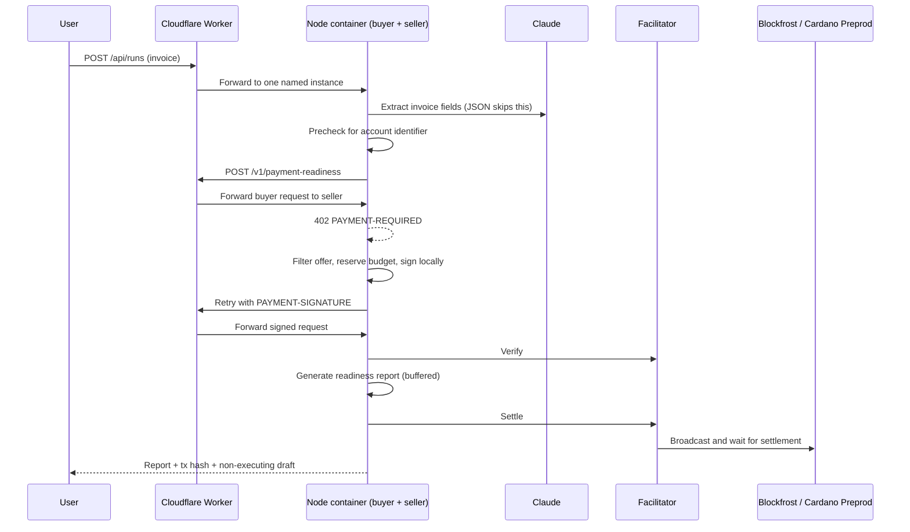

<p></p>

# PayLorya AI

**The AI CFO that checks before it pays.** Claude reads. Code decides. You approve.

PayLorya AI reads every financial document a business receives (invoices, receipts, statements,
contracts), turns it into a live ledger, plans budgets and cash, and drafts payments. Before the
agent pays a supplier it **buys a payment-readiness check per request with x402 on Cardano**:
no subscription, no API key, a capped price in tADA. The payout then runs within limits the owner
sets, from the customer's own wallet (signed in Lace) or their CashXChain account.

**Live:** https://paylorya.valentin.is · Built for the TUM Blockchain & AI Hackathon 2026, Cardano track.

## Demo and proof

| | |
| --- | --- |
| Live product | https://paylorya.valentin.is (sign up with an email code or Google) |
| Demo video | `<VIDEO_URL>` |
| Paid x402 request on Cardano Preprod | [`4e959d66…87b2`](https://preprod.cardanoscan.io/transaction/4e959d66ee947505292fbb48c1ec10356ed70b1751dab98b1ad2f37591ea87b2): 2 tADA for one readiness report, settled 30 Oct 2026 23:33 UTC ([evidence](evidence/live-run-2026-10-30T23-32-37-254Z.json)) |
| Safety run on the live deployment | Duplicate invoice refused before signing; invoice without account details stopped without paying ([evidence](evidence/safety-2026-10-31T00-46-10-335Z.json)) |

## The paid job, end to end

1. **Upload** a supplier invoice (PDF, photo or text) in the dashboard or the chat.
2. **Claude extracts** payee, amount, due date and payment details into structured data. Instructions
   hidden in a document are reported, never followed.
3. **The agent drafts a payment.** The deterministic policy (`src/cfo/policy.ts`) decides: execute on
   its own (within per-payment and monthly limits, known payees only), wait for approval, or block.
4. **x402 on Cardano:** the agent calls the readiness API, gets `402 Payment Required`, checks the
   offer against its allowlist, price cap and budget, signs a tADA payment locally and retries. The
   facilitator verifies and settles on Preprod; the report comes back only after settlement, with the
   transaction hash and explorer link.
5. **Payout:** tADA from the customer's own Cardano wallet (built by the server from the wallet's
   UTxOs, signed in Lace via CIP-30, submitted by the server through Blockfrost) or fiat through the
   customer's CashXChain sandbox account. The agent itself only pays for the x402 check.
6. **Audit:** every step, by user, agent or system, lands in the activity log.

## Cardano stack

- **x402** with the official `@x402/*` SDK: scheme `exact`, network `cardano:preprod`, asset lovelace.
- **Blockfrost** (Preprod) for UTxOs, balances and settlement checks.
- **Evolution SDK** builds payouts from the customer's UTxOs; **CIP-30** wallets (Lace, Eternl) sign
  them in the browser. PayLorya AI never holds customer keys.
- Hosted x402 facilitator, with an in-process fallback (`LOCAL_FACILITATOR=true`).

## Product

- Marketing site, accounts (Better Auth: email code, Google, optional password) and dashboard on one domain.
- Dashboard: overview, AI CFO chat with files and photos, documents, payments and approvals, budgets,
  cash forecast, payees, connections (read or read & write), agent autonomy (read-only, guarded,
  full access), activity log.
- Runs on Cloudflare: Worker + Container (Node), D1 for data, R2 for documents.

Details: [docs/AI-CFO.md](docs/AI-CFO.md) · Deployment: [docs/DEPLOY.md](docs/DEPLOY.md)

## How it works in 60 seconds



Deployed on Cloudflare (Worker + Container). The buyer signs locally and does not broadcast. The facilitator holds no funds and broadcasts
the signed transaction. The seller returns the paid report only after successful settlement.
See [architecture](docs/ARCHITECTURE.md).

## Trust boundary

Claude extracts invoice fields; it receives no authority to choose a wallet, endpoint, price
or spending limit. Deterministic code checks `exact`, `cardano:preprod`, `lovelace`, the seller
allowlist, the price cap, available session budget and invoice payment locks before signing.
Defaults are 2 tADA per report, a 3 tADA price cap and a 20 tADA session budget; network fees
are additional and are not included in that report-price ledger.

The buyer serializes report purchases within its agent instance to avoid competing for the same
UTxOs. Separate deployments still need separate buyer wallets.

A signed payment with an unclear outcome becomes `SETTLEMENT_UNKNOWN`: its amount stays counted
and the invoice stays locked. Do not retry it blindly. The demo agent keeps this state in memory, so
there these protections do not survive a restart. AI CFO payments are stored in D1 and do: a payment
cut off by a restart goes back to approval and resumes under the same idempotency key, and a sent
tADA payout is settled from the chain. In the AI CFO, a payout runs only after the policy or a human
approves it.

## Real vs simulated

| Part | Implementation and evidence boundary |
| --- | --- |
| x402 request/response cycle | Real official `@x402/*` 2.29 SDK integration; chain side is stubbed in integration tests |
| Buyer → seller payment | tADA on Cardano Preprod (testnet), settled on the live deployment (see Demo and proof) |
| Transaction hash / explorer link | Stored only from a successful settle response containing a hash |
| Field extraction | Claude API (text, PDF, photos); JSON skips the model; amounts parsed deterministically |
| IBAN / BIC / ABA checks, duplicates | Real deterministic code; BIC is a format/country check, not bank ownership verification |
| Corridors, rails, fees, FX, ETA in the readiness report | Simulated (`demo-fixture`), labeled **Simulated route/fees** |
| Supplier payout | tADA from the customer's own wallet (signed in Lace) or the CashXChain sandbox, after the policy or a human approves |
| Compliance | Data-quality and routing check; not an AML, sanctions or KYB decision |

## Quick start

```bash
npm ci
cp .env.example .env
npm run wallet:new -- seller     # put SELLER_ADDRESS into .env
npm run wallet:new -- buyer      # put BUYER_MNEMONIC into .env, fund the printed address
```

1. Fund the buyer address with tADA from the [Cardano testnets faucet](https://docs.cardano.org/cardano-testnets/tools/faucet/).
2. Create a free Blockfrost **preprod** project and set `BLOCKFROST_PROJECT_ID`.
3. Set `ANTHROPIC_API_KEY` (optional; structured JSON invoices work without it).

```bash
npm run dev                      # http://localhost:8787 (keep running)
npm run preflight                # second terminal: every check PASS or WARN, no FAIL
npm run smoke:x402               # milestone 1: 402 -> preprod payment -> 200 + tx hash
```

### Milestone 1 runbook

1. `npm run preflight` checks env, both addresses, the Blockfrost key, the buyer balance
   (price + max fee + change min-UTxO, about 3.9 tADA for a 2 tADA price), the seller output
   min-UTxO, the facilitator's `/supported`, and the running server's live 402 offer. Fix every
   FAIL line; restart `npm run dev` after editing `.env`.
2. If the hosted facilitator FAILs, set `LOCAL_FACILITATOR=true` to verify and broadcast
   in-process via Blockfrost, restart, re-run preflight.
3. `npm run smoke:x402` validates the 402 against `.env`, signs through the same policy as the
   agent, prints the signed tx hash before sending, and waits for settlement (up to ~4 min).
   On success it writes `evidence/milestone1-<timestamp>.json` (public data only): commit it.
4. If it prints **PAYMENT STATE UNKNOWN**, do not re-run. Open the printed explorer link first:
   if the tx is there, the payment happened; if it is still absent after the printed validity
   window, a re-run is safe.

To deploy on Cloudflare, follow the [deployment runbook](docs/DEPLOY.md).
Current deployment files are [Dockerfile](Dockerfile),
[Worker](cloudflare/worker.ts) and [Wrangler configuration](wrangler.jsonc).
Use a separate cloud buyer wallet; keep credentials out of git and screenshots.

## API

| Endpoint | Role | Description |
| --- | --- | --- |
| `POST /v1/payment-readiness` | Seller, x402-paid | Body `{ invoice }`, header `Idempotency-Key`. Returns the readiness report |
| `POST /api/runs` | Agent | Body `{ input }` (invoice text or JSON). Starts a run |
| `GET /api/runs/:id` | Agent | State, timeline, payment proof, report, draft |
| `GET /api/health` | Both | Config status, buyer/seller address, spend |

## Development and tests

Node.js 22 or newer is required. Dependencies are pinned in `package-lock.json`.

```bash
npm ci
npm run typecheck
npm test
```

[`tests/agent-x402.test.ts`](tests/agent-x402.test.ts) exercises the real localhost x402 seller
middleware, resource server and buyer client with a stub signer and facilitator. It covers
verify → handler → settle, report withholding on settlement failure, unknown-settlement locks,
recipient and price rejection, budgets, paid-invoice rejection and concurrent invoice reservations.
Live Cardano settlement on the deployment is shown under Demo and proof. The other suites cover the
AI CFO (policy, payments, store, chat tools, auth), readiness, spend policy and the Cloudflare env.

## Limitations

- Testnet and sandbox only during early access: tADA on Cardano Preprod, fiat on the CashXChain sandbox. No real funds move.
- Readiness report routes, fees, FX and ETA are simulated and labeled as such.
- Not an AML, sanctions or KYB decision.
- The demo agent's runs and spend ledger are in memory and reset on restart; AI CFO data is durable in D1/R2.

## Team and license

Valentin Israel (CEO) and Korbinian Weber (CTO), CashXChain.
Built for the TUM Blockchain & AI Hackathon 2026, Cardano track.

© 2026 CashXChain Inc. All rights reserved (`UNLICENSED`).
