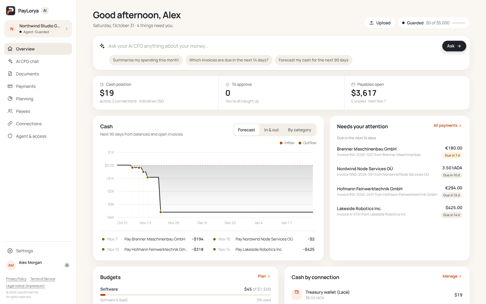
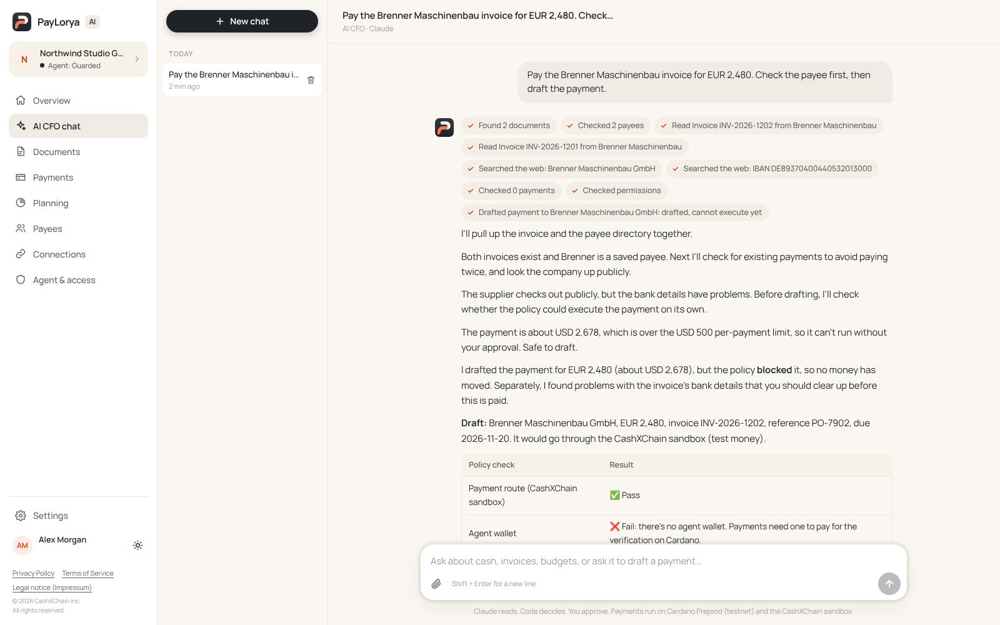
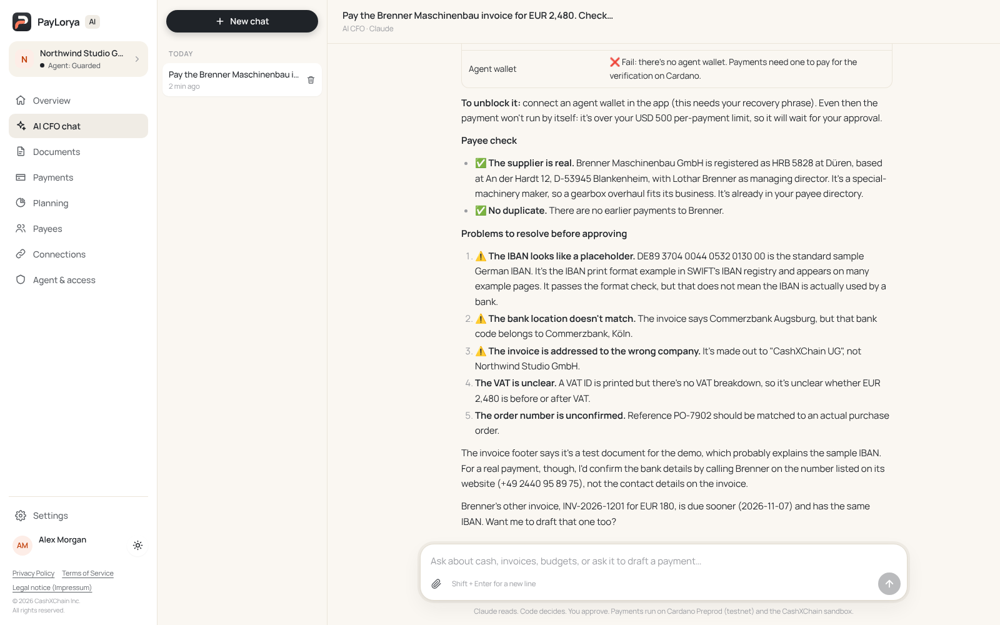
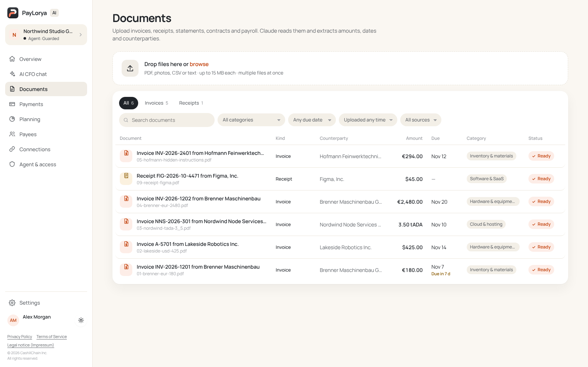
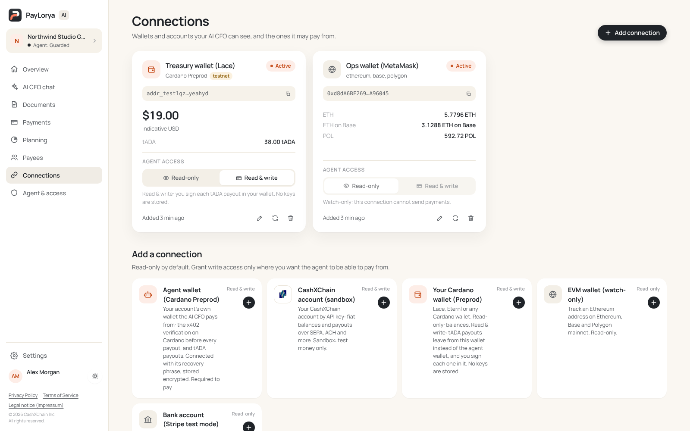
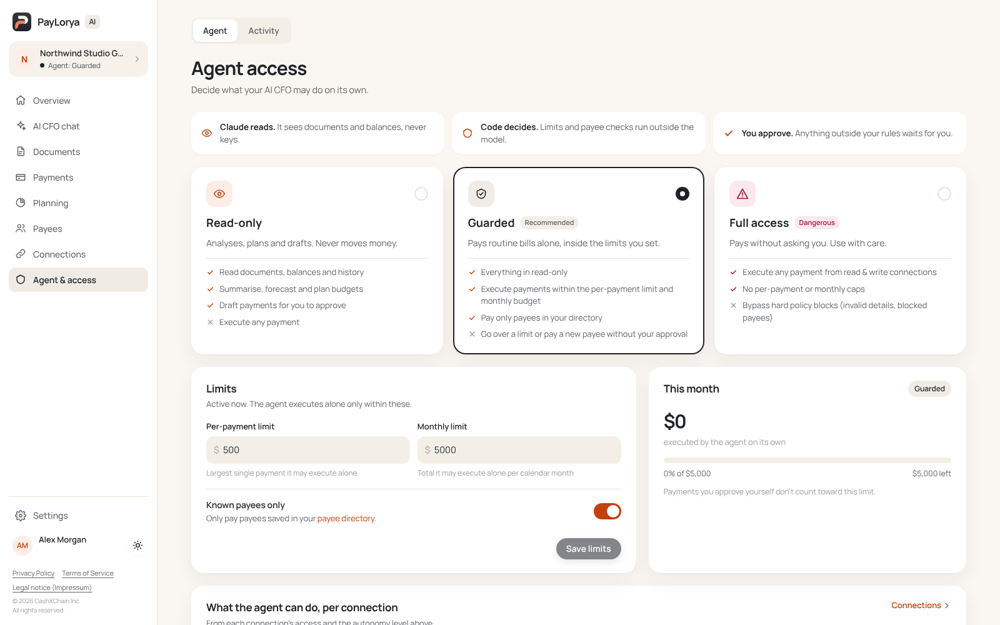
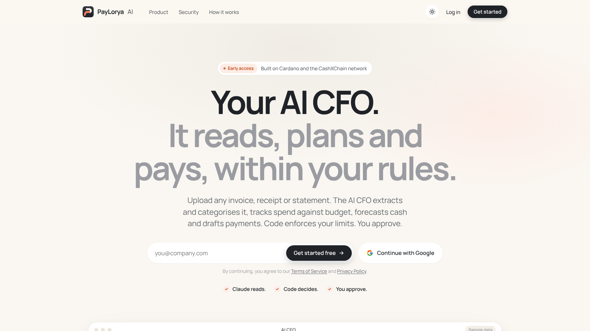
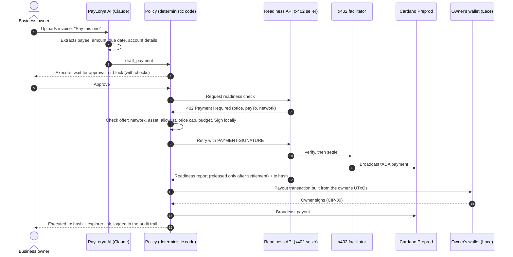

<p align="center">
  
</p>

<h3 align="center">A personal AI CFO for every business.</h3>

<p align="center">
  <b>Claude reads. Code decides. You approve.</b><br>
  It reads every financial document, plans budgets and cash, researches payees, and pays suppliers,
  buying a payment-readiness check per request with <b>x402 on Cardano</b> before any money moves.
</p>

<p align="center">
  <a href="https://paylorya.valentin.is"><b>Live product</b></a> ·
  <a href="#proof-on-cardano-preprod"><b>Proof on Preprod</b></a> ·
  <a href="#a-paid-job-end-to-end"><b>How it works</b></a> ·
  <a href="#run-it-locally"><b>Run it</b></a> ·
  <a href="docs/AI-CFO.md">Product docs</a>
</p>

<p align="center">
  
  
  
  
  
  
</p>

<p align="center">
  
</p>

---

## Why

Small businesses drown in invoices, receipts and statements, and **every supplier payment is a risk**:
wrong account details, duplicate invoices, fake invoices. AI agents could take this work over, but
nobody hands an agent the company account without hard limits.

PayLorya AI does the finance work **and** keeps the owner in control:

| | |
| --- | --- |
| 📄 **Reads everything** | Invoices, receipts, bank statements, contracts, payroll and tax documents (PDF, photo, CSV, text) become a live ledger. Instructions hidden in a document are reported, never followed. |
| 📈 **Plans** | Monthly budgets per category, spend analysis, and a 90-day cash forecast across bank accounts, wallets and CashXChain accounts. |
| 🔎 **Researches** | Checks suppliers and payees on the web before money moves, with sources cited. |
| 🧾 **Builds deliverables** | Excel forecasts, Word or PDF reports and charts, straight from the chat, saved as downloads. |
| 💸 **Pays, paid on Cardano** | Buys a payment-readiness check per request with **x402 on Cardano Preprod**, then pays from the customer's own wallet. |
| 🛡️ **Stays inside your rules** | A deterministic policy, not the model, decides whether a payment executes, waits for approval, or is blocked. |

## Screenshots

Taken from the live product (a demo workspace; documents read and the chat answered by the real AI CFO).

| | |
| --- | --- |
|  |  |
| **AI CFO chat.** Asked to pay an invoice, it reads both Brenner invoices, checks payees and earlier payments, searches the web, and drafts the payment through the policy. | **Payee check.** It confirms the supplier in the company register and flags a placeholder IBAN, a bank-location mismatch and a wrong addressee before anyone approves. |
|  |  |
| **Documents.** Invoices and receipts in EUR, USD and tADA, read into counterparty, amount, due date and category. | **Connections.** Own Cardano wallet (read & write, signed in Lace), MetaMask watch-only, CashXChain, banks via Stripe. |
|  |  |
| **Agent access.** Read-only, Guarded or Full access, with per-payment and monthly limits and known payees only. | **Sign-up** from the homepage with an email code or Google. |

## Proof on Cardano Preprod

| | |
| --- | --- |
| 🌐 **Live product** | https://paylorya.valentin.is (sign up with an email code or Google) |
| 🎬 **Demo video** | `<VIDEO_URL>` |
| ⛓️ **Paid x402 request** | [`4e959d66…87b2`](https://preprod.cardanoscan.io/transaction/4e959d66ee947505292fbb48c1ec10356ed70b1751dab98b1ad2f37591ea87b2): 2 tADA for one readiness report, settled 30 Oct 2026 23:33 UTC ([evidence](evidence/live-run-2026-10-30T23-32-37-254Z.json)) |
| 🧪 **Safety run on the live deployment** | Duplicate invoice refused before signing; invoice without account details stopped without paying ([evidence](evidence/safety-2026-10-31T00-46-10-335Z.json)) |

## A paid job, end to end



1. **Upload** a supplier invoice in the dashboard or the chat.
2. **Claude extracts** payee, amount, due date and payment details into structured data.
3. **The agent drafts a payment.** The policy (`src/cfo/policy.ts`) decides from the owner's settings:
   execute alone, wait for approval, or block. Its checks are shown on every payment.
4. **x402 on Cardano.** The agent calls the readiness API, receives `402 Payment Required`, checks
   the offer against its allowlist, price cap and budget, signs a tADA payment locally and retries.
   The facilitator verifies and settles on Preprod. The report comes back **only after settlement**:
   payment is tied to the result.
5. **Payout.** tADA from the owner's own Cardano wallet (the server builds the transaction, Lace
   signs it, the agent broadcasts), or fiat through the owner's CashXChain sandbox account.
6. **Audit.** Every step, by user, agent or system, lands in the activity log.

## Security model

Money decisions never belong to the model.

- **Claude has no authority.** It can read, research, plan and draft. It cannot approve payments,
  add payees, or change limits, autonomy or connection access. Those are the owner's controls.
- **A deterministic policy decides.** Per-payment limit, monthly limit, known payees only, write
  access per connection. Pure code, unit-tested.
- **The owner chooses autonomy.** Read-only, Guarded (default), or Full access (requires typing
  `FULL ACCESS`).
- **Untrusted input stays data.** Documents and web pages are treated as data. A prompt-injected
  invoice is reported to the owner, not followed.
- **The x402 buyer is strict.** It accepts only scheme `exact`, network `cardano:preprod`, asset
  lovelace, an allowlisted seller, a price under the cap (default 2 tADA, cap 3 tADA) and within the
  session budget (20 tADA). Purchases are serialized per instance to avoid UTxO contention.
- **No double payments.** A duplicate invoice is refused before signing. A settlement with an unclear
  outcome becomes `SETTLEMENT_UNKNOWN`: the amount stays counted and the invoice stays locked
  instead of being retried. AI CFO payments are stored in D1 and resume under the same idempotency
  key after a restart.
- **Non-custodial payouts.** Customer keys never reach the server: payouts are built from the
  wallet's UTxOs and signed in the wallet (CIP-30). The agent wallet only pays x402 fees.
- **Secrets stay sealed.** A workspace's own CashXChain key is stored encrypted (AES-256-GCM, key
  derived with HKDF) and shown only as a hint.


## Connections

| Connection | Read | Write | How |
| --- | :---: | :---: | --- |
| **Own Cardano wallet** (Lace, Eternl) | ✅ | ✅ | Server builds the payout, owner signs each one in the wallet (CIP-30). |
| **PayLorya agent wallet** (Cardano) | ✅ | x402 fees only | Pays readiness checks; never pays a workspace's payout. |
| **CashXChain account** (sandbox) | ✅ | ✅ | The workspace's own API key: fiat balances and payouts. |
| **Bank account** via Stripe Financial Connections | ✅ | — | Read-only balances feed cash and forecast. Bank login happens in Stripe's dialog. |
| **EVM address** via MetaMask (Ethereum, Base, Polygon) | ✅ | — | Watch-only. |

## The AI CFO

A streaming chat with tools over real workspace data: overview, documents, transactions, open
invoices, cash forecast, budgets, payees, payments and its own permissions. On top of that:

- **Web search and fetch** to research payees, with sources.
- **Code execution** in a Python sandbox to build Excel, Word, PDF, PowerPoint, CSV and charts.
  Generated files are saved to the workspace and linked in the reply.
- **Adaptive thinking** with high effort for multi-step analysis.
- Files and photos can be attached to any message.

## Built with

| Layer | Technology |
| --- | --- |
| Payments | [x402](https://developers.cardano.org/x402/) (official `@x402/*` 2.29 SDK, `exact`, `cardano:preprod`), hosted facilitator with in-process fallback |
| Cardano | Blockfrost (Preprod), Evolution SDK, CIP-30 wallets (Lace, Eternl) |
| AI | Claude API (Anthropic): structured extraction, tool use, web search and fetch, code execution |
| App | TypeScript, Node.js 22, Express, Better Auth (email code, Google, optional password) |
| Infrastructure | Cloudflare Workers + Containers, D1 (data), R2 (documents), Cloudflare for SaaS (custom domain) |
| Integrations | Stripe Financial Connections, CashXChain sandbox API, Resend |

```
Browser ──▶ Cloudflare Worker ──▶ Container (Node: app, AI CFO, x402 buyer + seller)
               │   static assets at the edge         │
               │                                      ├──▶ Claude API
               └── D1 + R2 ◀── outbound handler ◀─────┤──▶ Blockfrost / Cardano Preprod
                                                      ├──▶ x402 facilitator
                                                      └──▶ Stripe, CashXChain sandbox
```

More: [architecture](docs/ARCHITECTURE.md) · [AI CFO product docs](docs/AI-CFO.md) · [technical notes](docs/TECHNICAL.md)

## Run it locally

Requires Node.js 22+.

```bash
npm ci
cp .env.example .env
npm run wallet:new -- seller     # put SELLER_ADDRESS into .env
npm run wallet:new -- buyer      # put BUYER_MNEMONIC into .env, fund the printed address
```

1. Fund the buyer address with tADA from the [Cardano testnets faucet](https://docs.cardano.org/cardano-testnets/tools/faucet/).
2. Create a free Blockfrost **preprod** project and set `BLOCKFROST_PROJECT_ID`.
3. Set `ANTHROPIC_API_KEY` for the AI CFO (structured JSON invoices work without it).

```bash
npm run dev           # http://localhost:8787: site, sign-up, dashboard (keep running)
npm run preflight     # second terminal: every check PASS or WARN, no FAIL
npm run smoke:x402    # 402 -> Preprod payment -> 200 + tx hash, writes evidence/
```

<details>
<summary><b>x402 runbook: preflight, smoke test, recovery</b></summary>

1. `npm run preflight` checks env, both addresses, the Blockfrost key, the buyer balance
   (price + max fee + change min-UTxO, about 3.9 tADA for a 2 tADA price), the seller output
   min-UTxO, the facilitator's `/supported`, and the running server's live 402 offer. Fix every
   FAIL line; restart `npm run dev` after editing `.env`.
2. If the hosted facilitator FAILs, set `LOCAL_FACILITATOR=true` to verify and broadcast
   in-process via Blockfrost, restart, re-run preflight.
3. `npm run smoke:x402` validates the 402 against `.env`, signs through the same policy as the
   agent, prints the signed tx hash before sending, and waits for settlement (up to ~4 min).
   On success it writes `evidence/milestone1-<timestamp>.json` (public data only).
4. If it prints **PAYMENT STATE UNKNOWN**, do not re-run. Open the printed explorer link first:
   if the tx is there, the payment happened; if it is still absent after the printed validity
   window, a re-run is safe.

</details>

**Deploy to Cloudflare:** follow the [deployment runbook](docs/DEPLOY.md)
([Dockerfile](Dockerfile), [Worker](cloudflare/worker.ts), [Wrangler config](wrangler.jsonc)).
Use a separate cloud buyer wallet; keep credentials out of git and screenshots.

## API

**Public API** for your own systems and AI agents: account API keys, scopes, idempotency, an MCP server
(`/mcp`, with OAuth sign-in for claude.ai connectors) and webhooks. Docs: [docs/API.md](docs/API.md), on
the site at [`/developers`](https://paylorya.valentin.is/developers), spec at [`/openapi.json`](public/openapi.json).

| Endpoint | Role | Description |
| --- | --- | --- |
| `POST /v1/payment-readiness` | Seller, x402-paid | Body `{ invoice }`, header `Idempotency-Key`. Returns the readiness report after settlement |
| `/api/v1/*` | Dashboard (session) and public API (`Bearer ply_sk_…`) | Workspace, documents, chat (SSE), payments, budgets, payees, connections. Contract: [`web/src/dashboard/types.ts`](web/src/dashboard/types.ts) |
| `/mcp` | MCP server | Streamable HTTP; API key or OAuth (`/authorize`, `/token`, `/register`, `/.well-known/*`) |
| `/api/auth/*` | Better Auth | Email code, Google, password |
| `POST /api/runs`, `GET /api/runs/:id` | Demo agent | Invoice run with timeline, payment proof, report, draft |
| `GET /api/health` | Both | Config status, buyer/seller address, spend |

## Tests

```bash
npm run typecheck
npm test              # 427 tests across 26 files
```

[`tests/agent-x402.test.ts`](tests/agent-x402.test.ts) runs the real localhost x402 seller middleware,
resource server and buyer client with a stub signer and facilitator: verify → handler → settle, report
withholding on settlement failure, unknown-settlement locks, recipient and price rejection, budgets,
paid-invoice rejection and concurrent reservations. Other suites cover the AI CFO policy, payments,
store, chat tools and generated files, auth, wallet signing, Stripe connections and the Cloudflare
Worker env. Live Cardano settlement is shown under [Proof on Cardano Preprod](#proof-on-cardano-preprod).

## Real vs simulated

We keep this boundary explicit.

| Part | Status |
| --- | --- |
| x402 payment for the readiness check | **Real**, tADA on Cardano Preprod (testnet), settled on the live deployment |
| Payouts from the owner's wallet | Implemented: Preprod transactions built server-side, signed in Lace (CIP-30), broadcast by the agent |
| Document reading, web research, file generation | **Real** Claude API |
| Bank balances | **Real** Stripe Financial Connections (test or live keys) |
| Fiat payouts | CashXChain **sandbox** (test money) |
| IBAN / BIC / ABA checks, duplicates | Real deterministic code; BIC is a format/country check, not bank ownership verification |
| Routes, fees, FX and ETA in the readiness report | **Simulated**, labeled "Simulated route/fees" |
| Compliance | Data-quality and routing checks; not an AML, sanctions or KYB decision |

No real funds move during early access.

## Roadmap

- **Mainnet:** a network parameter plus an external security audit of the policy and payment paths.
- **Agent marketplace:** offer the readiness check to other agents (x402) and hire specialist agents
  per job (Masumi escrow).
- **Live banking:** Stripe Financial Connections in live mode with transactions in the ledger; live
  CashXChain rails for fiat payouts.
- **Teams:** multiple approvers, approval chains, role-based limits.

## Team

**Valentin Israel** (CEO) and **Korbinian Weber** (CTO), [CashXChain](https://www.cashxchain.com).
Built at the TUM Blockchain & AI Hackathon 2026, Cardano track.

© 2026 CashXChain Inc. All rights reserved (`UNLICENSED`).
