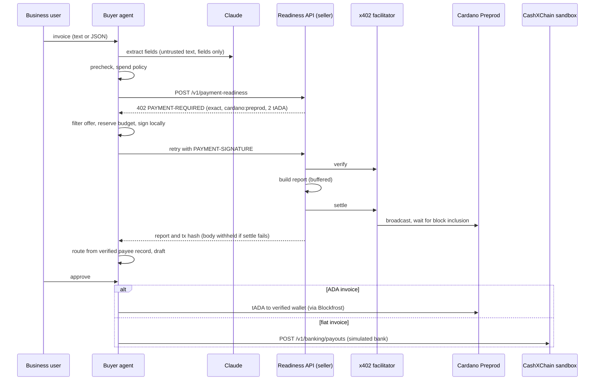

# PayLorya AI: technical description

Source for the Cardano track submission (TUM Blockchain & AI Hackathon 2026). Each statement is
backed by code, `evidence/*.json` or [ARCHITECTURE.md](ARCHITECTURE.md). Snapshot: `main`,
2026-10-31. Testnet only: Cardano Preprod, tADA.

**Paid request on Cardano Preprod:** tx
`4e959d66ee947505292fbb48c1ec10356ed70b1751dab98b1ad2f37591ea87b2`
([explorer](https://preprod.cardanoscan.io/transaction/4e959d66ee947505292fbb48c1ec10356ed70b1751dab98b1ad2f37591ea87b2),
`evidence/live-run-2026-10-30T23-32-37-254Z.json`).

## 1. Summary

A business that pays supplier invoices wants an agent to prepare the payment. Reading the invoice
is the easy part. The hard part is knowing that the payment is safe to send. The account may be
invalid, a field may be missing, the invoice may be a duplicate, or the bank details may have been
swapped (invoice redirection). The **PayLorya Readiness API** (`POST /v1/payment-readiness`)
sells that check for **2 tADA per report, paid via x402 on Cardano Preprod**. Our Claude-based
agent is its first customer. The agent:

- extracts the invoice fields;
- buys the report within a deterministic spend policy;
- routes the payout to a verified payee only;
- pays the invoice only after a human approves.

## 2. End-to-end flow

1. **Invoice in:** `POST /api/runs`, with invoice text or JSON. Rate limits and a text-length gate
   run before any model call (section 4).
2. **Extraction (Claude):** `src/extract.ts` uses structured output with `effort: "low"`. The trust
   boundary applies here:
   - the invoice is wrapped in `<invoice>` as untrusted data;
   - the schema holds invoice fields only, with no wallet, endpoint, price or limit;
   - code converts amounts to integer minor units (`parseAmountMinor`), not the model;
   - JSON input skips the model, and there is no model fallback.
3. **Deterministic precheck:** an IBAN, a routing number or (for ADA) a Cardano address must be
   present. Otherwise the run ends `NEEDS_INFO` and nothing is paid.
4. **The agent hires the readiness API via x402** (`buyReport()` in `src/agent.ts`, `src/seller.ts`):
   - **402:** the seller answers `PAYMENT-REQUIRED` with `exact`, `cardano:preprod`, `lovelace`,
     `2000000` and payTo = seller.
   - **Sign:** the spend policy filters the offer (section 4). The buyer wallet signs locally, and
     the client retries with `PAYMENT-SIGNATURE`. The buyer never broadcasts.
   - **Verify, handler, settle:** `@x402/express` calls facilitator verify, runs the readiness
     handler with its body **buffered**, then calls settle. Settle broadcasts and waits for block
     inclusion (`CARDANO_L1_CONFIRMATIONS=0` on the deployment since A8; the spec default is 1
     newer block).
   - **Payment tied to the result:** settle runs only after the report was produced. A handler
     status of 400 or higher cancels settlement. A failed settle drops the body and returns 402.
     The tx hash is stored only from a successful settle response for the tx the buyer signed, and
     the report must carry the run's invoice fingerprint.
5. **Route** (`decideRoute()` in `src/routing.ts`): the payee must be in the verified directory.
   The currency picks the rail, and the destination comes from the payee record. The run ends
   `DRAFT_READY`, or `BLOCKED` if the route is blocked.
6. **Human approval:** `POST /api/runs/:id/approve` with the operator token (`APPROVE_TOKEN`,
   fail-closed). The route is derived again at execution time and must match the draft.
7. **Payout from verified payee data only:**
   - **tADA on Cardano Preprod:** a plain lovelace transfer from the buyer wallet to the verified
     wallet, sent via Blockfrost `/tx/submit`, with a wait of up to 120 s.
   - **Fiat via the CashXChain sandbox:** `src/payout-cashxchain.ts` registers the beneficiary
     from the payee record and sends `POST /v1/banking/payouts` with
     `Idempotency-Key: payout-<payoutKey>`. It then polls to a final status. The bank is simulated
     by the sandbox (test ledger). Without `CASHXCHAIN_API_KEY`, a labeled simulation runs and no
     API is called.

The report fee and the invoice payout are separate transactions with separate budgets.

## 3. Cardano tools used

| Tool | Version | Use |
| --- | --- | --- |
| `@x402/cardano` | 2.29.0 | `ExactCardanoScheme` on the client (signs) and the server (builds the offer). `toClientCardanoSigner` is the mnemonic wallet on Blockfrost. `toFacilitatorCardanoSigner` is a key-free submitter for payouts. `decodeCardanoTransaction` gives the hash of a signed tx. `addressCredentials` tells key addresses from script addresses |
| `@x402/core` | 2.29.0 | `HTTPFacilitatorClient`, `x402ResourceServer` and `x402Client` (the latter two re-exported by `@x402/express` and `@x402/fetch`). `x402Facilitator` powers the fallback facilitator |
| `@x402/express` | 2.29.0 | `paymentMiddleware`: 402 offer, then verify, buffered handler, settle |
| `@x402/fetch` | 2.29.0 | `wrapFetchWithPayment`, `x402HTTPClient` (settle response, verify error) |
| x402 scheme | `exact` | Accepted only with `cardano:preprod`, `lovelace` and the `default` transfer method |
| Hosted x402 facilitator | Preprod | `https://x402.preprod.dev.ecosyseng.cf-deployments.org` (default in `src/config.ts`). `/supported` was checked live on 2026-10-30: x402 v2, `exact`, `cardano:preprod`, `l1Confirmations` 0 to 20. The fallback `LOCAL_FACILITATOR=true` was not used in the evidence runs |
| Blockfrost | Preprod REST | UTxOs and protocol parameters for signing (via `@x402/cardano`), payout broadcast, wallet sync (`GET /txs/{hash}`), reconciliation (`GET /txs/{hash}/utxos`, `GET /blocks/latest`) |
| Evolution SDK | 0.5.19 | `@evolution-sdk/evolution`, a dependency of `@x402/cardano`. It builds and decodes transactions and parses addresses. We do not call it directly |
| tADA | Preprod | 2 tADA per report (cap 3 tADA). Invoice payouts from 1 to 10 tADA |
| Preprod explorer | – | `EXPLORER_TX_URL`, default `https://preprod.cardanoscan.io/transaction/` |

Hosting: one Cloudflare Worker in front of one Cloudflare Container (`max_instances: 1`), live at
`https://cxc-agentpay.cashxchain.workers.dev`.

## 4. Safety model

| Control | Mechanism |
| --- | --- |
| Spend policy | Offers must be `exact`, `cardano:preprod`, `lovelace` and `default`. The payTo must be on the allowlist (`SELLER_ADDRESS` only). The price cap is 3 tADA and the session budget 20 tADA. At most 1 payment per run |
| One payment per invoice | `SpendLedger.reserve()` checks and holds the budget plus the invoice fingerprint in one step before signing. The hold is released only if signing threw |
| `SETTLEMENT_UNKNOWN` | Covers any failure after signing: a transport error, a verify rejection, a failed settle, a "success" without a hash or for a tx other than the one we signed. The amount is counted, the invoice locked and the tx hash kept. A paid request without a usable report, or with a report for another invoice, ends `FAILED` and stays locked as paid |
| `PAYOUT_UNKNOWN` | Covers any payout error after signing or sending. The amount is counted and the invoice locked. Only a provable non-send (Blockfrost submit HTTP 400, or a definitive CashXChain refusal) returns the run to `DRAFT_READY`. A fiat unknown keeps CashXChain's payout id |
| Reconciliation | For a Cardano tx in an unknown state, a background check polls Blockfrost for 20 min. The exact amount to the expected address on chain resolves it as paid (report: `FAILED` with proof, locked; payout: `EXECUTED`). A tx we signed whose TTL is 600+ slots behind the tip and still not indexed is proven expired and refunded |
| Wallet queue and sync | One tx in flight per buyer wallet, for fees and payouts alike. Before the next tx, the agent waits until Blockfrost has indexed the previous one (up to 90 s), plus a 30 s grace period. Every tx that may have been broadcast counts, including A7's 504 case; only a verify rejection is skipped |
| Payout key | sha256 of the directory payee name, the normalized invoice id, the currency and the amount, all verified inputs. It keys the payout ledger and the CashXChain `Idempotency-Key` |
| Invoice redirection | An invoice wallet, IBAN or routing/account that differs from the verified record leads to `BLOCKED`. An unknown payee makes the draft not executable |
| Approval and caps | A human approves each payout in a confirmation window that shows amount, source account or wallet, verified destination, check proof and budget. A second click returns 409. `APPROVE_TOKEN` is required (fail-closed: unset disables approvals) and compared in constant time. Defaults: tADA payouts up to 10 tADA each and 30 tADA in total; fiat up to 1,000.00 each, 5,000.00 per currency and 5 payouts per session. The operator can change these at runtime within hard maximums |
| Chat with functions | Claude can read balances, budgets, invoices and payees, submit an invoice the user wrote, and open the confirmation window. It has no function that approves or pays |
| Seller idempotency | The run id is the `Idempotency-Key`. A key reused for another invoice gets 409 before settle, so a public run id cannot be used to plant a report |
| Public endpoint | `POST /api/runs`: free text over 20,000 characters is refused (413) before any model call; 10 runs per minute per client IP and 120 per hour overall (429 with `Retry-After`); at most 500 stored runs, evicting settled ones first, never in-flight ones |
| Keys | The seller holds no signing key, and the facilitator holds no funds. The CashXChain URL is fixed to the sandbox, and live keys are refused at startup |

**AI can:** return 11 invoice fields from the text.

**AI cannot:**
- set the network, asset, fee recipient, price, budget or caps;
- choose a payout destination;
- convert amounts;
- approve a payout;
- retry an unknown payment.

In both live injection runs, Claude extracted the correct supplier and EUR 8,940.00 from the
hostile invoice.

## 5. Real vs simulated

| Part | Status |
| --- | --- |
| x402 cycle, report fee buyer to seller | **Real** on Cardano Preprod, in tADA (test funds), official `@x402/*` 2.29.0 |
| Field extraction | **Real** Claude API call for text. Amounts are parsed in code |
| Account checks, duplicate detection | **Real** deterministic code: IBAN mod-97, BIC format, ABA checksum, Cardano bech32. The BIC check does not prove bank ownership |
| Corridors, fees, FX, ETA in the report | **Simulated** (`demo-fixture`, "Simulated route/fees") |
| Payee directory | **Synthetic** demo records |
| tADA invoice payout | **Real code path** after approval. **No live payout has run yet** |
| Fiat invoice payout | **CashXChain sandbox** with its key (simulated bank, no real money). Otherwise a labeled simulation. Tested only against an offline fake so far |
| Compliance | The report checks data quality and routing. It is not an AML, sanctions or KYB decision |

## 6. Evidence

All runs used the live deployment and the hosted facilitator. Explorer link = `EXPLORER_TX_URL` + hash.

| Tx | Run (UTC) | What it proves |
| --- | --- | --- |
| [`4e959d66…a87b2`](https://preprod.cardanoscan.io/transaction/4e959d66ee947505292fbb48c1ec10356ed70b1751dab98b1ad2f37591ea87b2) | 10-30 23:33, milestone 1 | First paid request end to end: 2 tADA from buyer to seller, `PAID` after 32.4 s, run ended `DRAFT_READY`. Block 5354949, fee 0.168581 tADA, outputs checked on Koios |
| [`82ac1a61…ad57e`](https://preprod.cardanoscan.io/transaction/82ac1a611631579d03618947d11e5ca3467220c479f97e1460f67c5155aad57e) | 10-30 23:56, repeat-invoice | Paid after 23.0 s. The repeat of the same invoice was refused before signing, with spend unchanged |
| [`7df56c37…cd063`](https://preprod.cardanoscan.io/transaction/7df56c37f30bb40f180c340ddfd4cd7b92b7d714baffd9bdbea15d5f1e4cd063) | 10-31 00:46, repeat-invoice | Paid after 35.8 s. The repeat waited 28.9 s for the wallet sync, then was refused before signing |
| [`8f05dd11…4ffc1`](https://preprod.cardanoscan.io/transaction/8f05dd119428d53511de6c1dade9ed189c62e0cae53dbeefe3b85ce7ce54ffc1) | 10-31 00:48, prompt-injection | Settle hit an nginx **504** after about 65 s, yet the tx is on chain (block 5355152). It paid exactly 2 tADA to the seller and nothing to the attacker address. The agent stayed in `SETTLEMENT_UNKNOWN` with the invoice locked and did not retry. The script marks the scenario FAIL because the run did not end cleanly |
| `3f1acfbd…aa0f` | 10-30 23:56, prompt-injection | Rejected at verify and never broadcast. The agent still locked the invoice and counted 2 tADA (conservative). Not a payment proof |

Missing account: `NEEDS_INFO` in both safety runs, nothing paid. Files:
`evidence/live-run-2026-10-30T23-32-37-254Z.json`, `evidence/safety-2026-10-30T23-56-11-205Z.json`,
`evidence/safety-2026-10-31T00-46-10-335Z.json`.

## 7. How it could run in real use

1. **Mainnet and stablecoin pricing:**
   - `@x402/cardano` 2.29.0 ships `DEFAULT_ASSETS` with USDM (mainnet) and tUSDM (preprod).
   - Our code is pinned to `cardano:preprod` and `lovelace`. Moving means changing the network
     and asset config and the ledger units, plus a mainnet wallet with its key in a key store.
   - The next step is tUSDM on Preprod.
2. **Persistent ledgers:** runs, spend and payout ledgers, duplicates and fiat counters move from
   memory to a durable store with the same reserve, paid and unknown semantics. Reconciliation of
   unknown states then survives restarts and runs past the 20-minute window.
3. **Authenticated users and approvers:** company accounts, named approvers with limits, and an
   audit log. The verified vendor master replaces the synthetic directory.
4. **CashXChain production rails, through its regulated partners:**
   - production needs a live key and an account that is `active` after KYB by the banking partner;
   - payouts run on bank schemes such as SEPA and ACH, and settle in minutes to days;
   - production adds a payee-name check;
   - the CashXChain API offers no stablecoin payouts;
   - all of this is subject to KYB, partner approval and legal review.
5. **Real report data:** CashXChain corridors and payout quotes replace the fixtures. The client
   methods exist in `src/cashxchain.ts` but are not used by the report yet.
6. **Other agents as buyers:** the readiness API is a plain paid HTTP endpoint. Any x402 client
   with a Cardano wallet can buy from it. Duplicate detection must then be scoped per caller
   (today it is shared), and the seller endpoint needs its own per-caller limits (today only the
   agent's `POST /api/runs` is rate-limited).
7. **Monitoring:** alerts on `*_UNKNOWN` states, facilitator errors and latency (see the 504),
   wallet balance and budgets, and a live-tested fallback facilitator.

## 8. Known limitations

- State lives in memory in one container. A restart resets runs, ledgers and locks, including
  the only guard against paying a tADA invoice twice.
- Testnet only, with synthetic invoices and payees.
- Not yet verified live:
  - a tADA invoice payout;
  - CashXChain sandbox payouts;
  - the Blockfrost HTTP 400 rejection classifier;
  - the `LOCAL_FACILITATOR` evaluate call;
  - exact copying of 100+ character addresses by Claude (a wrong character fails safe to
    `NEEDS_INFO`);
  - the Cardanoscan link format, in a browser;
  - reconciliation against real Blockfrost responses, and settle times with
    `CARDANO_L1_CONFIRMATIONS=0`;
  - that `CF-Connecting-IP` reaches the container (`/api/health` -> `limits.clientIdFrom`).
- Approvals are disabled unless `APPROVE_TOKEN` is set. Fiat unknown states and Cardano unknowns
  that neither land nor expire within 20 minutes are resolved by a human.

## Left out (could not verify)

- **Facilitator operator:** `.env.example` names the Cardano Foundation; this was not confirmed.
- **On-chain state of `82ac1a…` and `7df56c37…`:** only the settle response records them, and
  Koios and Cardanoscan were not reachable from this session.
- **Live configuration:** whether `APPROVE_TOKEN` is set on the live deployment, and whether the
  current `main` is deployed.
- **CashXChain claims:** any licence, MiCAR/PSD2 status, settlement speed or fees.
